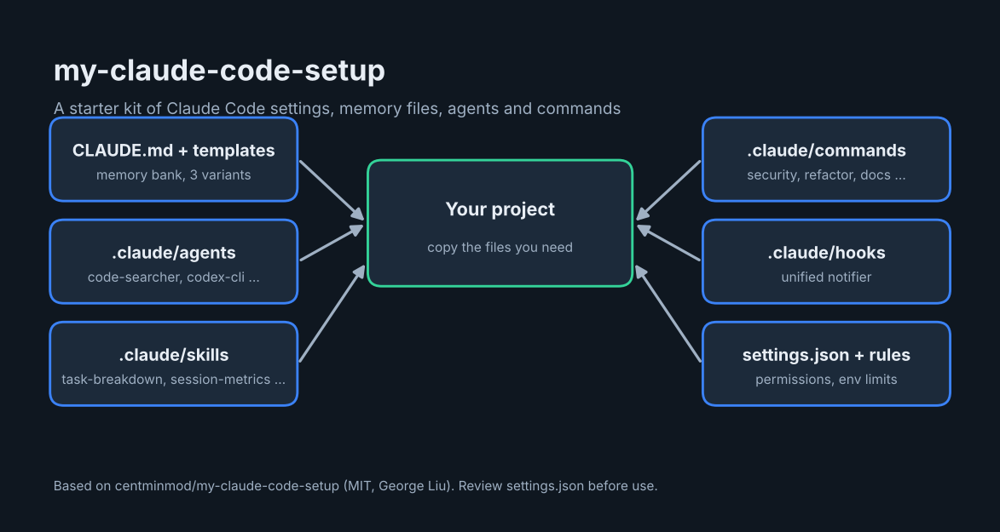

# my-claude-code-setup: overview



A starter kit of **Claude Code project settings**: a memory-bank style `CLAUDE.md`, ready-made agents, skills, slash commands and a notification hook. You copy the parts you want into your own project.

Upstream project: [centminmod/my-claude-code-setup](https://github.com/centminmod/my-claude-code-setup) by George Liu, license MIT.

## What is inside

| Path | Contents |
| --- | --- |
| `CLAUDE.md` and `CLAUDE-template-1/2/3.md` | A memory-bank system that helps Claude retain context across sessions, plus three template variants and a migration prompt. |
| `.claude/agents/` | Sub-agents such as `code-searcher`, `codex-cli`, `memory-bank-synchronizer`, `ux-design-expert`. |
| `.claude/skills/` | Skills such as `task-breakdown`, `session-metrics`, `claude-docs-consultant`, `consult-codex`. |
| `.claude/commands/` | Slash commands grouped by purpose (security, architecture, refactor, documentation, cleanup, and more). |
| `.claude/hooks/` | `unified_notifier.py`, a notification hook. |
| `.claude/settings.json`, `.claude/rules/` | Permissions, environment limits and core rules. |
| `CLAUDE-cloudflare*.md`, `CLAUDE-convex.md` | Optional reference docs for Cloudflare and Convex projects. |

## How to use it

1. Copy the files you want into your project folder.
2. Edit `CLAUDE.md` and the templates to fit your project.
3. Start Claude Code in that folder and run `/init` so it fills the memory-bank files.
4. The upstream README suggests `brew install ripgrep fd jq` on macOS, and Terminal-Notifier for the notification hook (remove `.claude/settings.json` hooks if you do not use macOS).

## Things to know

- **Review `.claude/settings.json` before copying it.** It pre-approves many shell commands (for example `curl`, `chmod`, `cp`). Keep only what you are comfortable allowing.
- `.claude/settings.local.json` is a personal settings file; do not copy it blindly.
- Four alternative README guides are included (`README-v2.md` to `README-v4.md`) in different styles.

---

Overview prepared by Ashraf Saed | MIGATRONIX. The project itself belongs to its original authors; see its license.

## Automatic install

```bash
git clone https://github.com/AshrafSaed/my-claude-code-setup-guide.git
cd my-claude-code-setup-guide
bash install.sh
```

Or open this folder in Claude Code and say "install my-claude-code-setup": the skill `install-my-claude-code-setup` (in `.claude/skills/`) runs the same script.

- Copies templates from the upstream repo into the CURRENT project folder. It does not overwrite existing files and skips `.claude/settings.json` (it pre-approves many shell commands; review it first).
- After install: Open Claude Code in the project and run `/init`.
